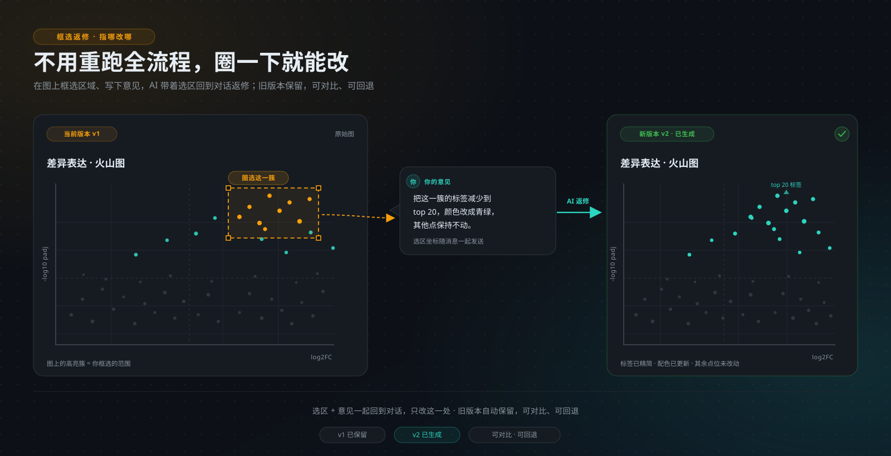

# 言出法随 · YCFS_APP

言出法随是 Biomamba 的生信分析与文献阅读工作台。在浏览器里打开一个会话，上传数据、说明分组和研究问题，就可以运行 R、Python 或 Bash。脚本、执行日志和结果文件都留在这个会话里，改参数或补图时可以接着做。

[进入工作台](https://www.biomamba.cn/YCFS_APP/) · [文献速递使用指南](https://www.biomamba.cn/YCFS_APP/guide/literature) · [更新日志](CHANGELOG.md)

## 第一次用，从哪里开始

- **手里有数据**，登录后点「新建对话」，上传数据和样本说明。告诉它要比较哪两组、先检查什么、最后要交哪张表或图。
- **手里有脚本**，在会话里切到「代码者」。编辑器、控制台、变量和工作区放在一起，适合逐段运行、核对中间结果。
- **手里有研究问题**，从「文献速递」新建检索。先定关键词和范围，再选精读或略读篇数。读到值得复现的方法，可以从报告转入分析会话。

## 从一份表达矩阵开始

把原始计数矩阵和样本信息表上传到同一个会话。第一次提问可以具体到要检查哪两列：

> 先核对矩阵列名和样本表的 sample_id，列出缺失和重复项。确认分组无误后，用 DESeq2 比较处理组和对照组，导出完整结果表，并标明 log2FoldChange 的方向。

在执行记录里可以查看实际运行的代码、参数和退出状态。需要复核某个基因，就打开结果表；需要调整火山图，就在原会话里指定阈值、标签或配色。项目完成后可以下载脚本、图表和报告，也可以把会话以只读或可写权限分享给同事。

## 自己改代码，或让技能参与分析

在「代码者」里，可以选中一段代码，写下“保留原始计数，另存一份归一化矩阵”，看过修改差异后再决定是否保存。如果分析结果和预期不符，先在控制台检查矩阵维度、样本顺序和分组，再决定该改哪一步。

技能库里可以按分析方向、标签或作者找技能，挂到当前会话。比如做单细胞分析时选质控和注释相关技能，准备组会时再选科研绘图或文献精读。下面这些要求可以直接改成自己的样本名和分组。

| 手头的工作 | 可以怎样开头 | 建议先核对的结果 |
| --- | --- | --- |
| 单细胞质控 | “按样本画出基因数和线粒体比例的分布，先给我看过滤前后的变化。” | 每个样本保留的细胞数、过滤阈值 |
| 空间转录组 | “把这个基因的表达叠到组织切片上，两组切片用相同色标。” | 切片编号、坐标是否对齐、图例范围 |
| 生存分析 | “按临床表中的分组画生存曲线，在图下放风险人数表。” | 事件编码、随访时间单位、各组人数 |
| 通路富集 | “用本次检测到的基因做背景，分别分析上调和下调基因。” | 基因 ID 转换、背景集、校正后的显著性 |

## 围绕一个问题读文献

在「文献速递」新建检索，填入关键词、年份、阅读方式和篇数。如果只关心某类证据，可以直接写进要求，例如“找有独立队列验证的研究，并注明发现队列和验证队列各有多少人”。

- **解读与报告**按项目保存题录和阅读结果。有可用原图时，可以对照图注和报告解读，再打开论文核对样本、分组和统计单位。
- **文献思路图**有三种读法。想弄清论文的问题和结论，选「文章逻辑图」；想复现实验或分析，选「技术路线图」；想在组会上讨论还缺什么证据，选「研究延伸图」。可以限定“只看第一篇”。在新生成的图上点一个节点，就能看到它引用的报告摘录。摘录在当前报告中有唯一匹配时，还可以跳到对应段落。
- **学术前沿订阅**适合长期跟踪一个问题。例如，把检索保存为每周一运行，保留关键词、年份和阅读偏好。邮件服务可用时，可选择接收过程提示或阅读结果。

看研究延伸图时，可以先问一句：“作者实际测量了什么？”图上将报告里的观察和待验证的方向分开标注。点击节点看到的是生成当时的报告摘录；需要引用论文时，再回到原文核对实验条件、图号和作者表述。

## 复核、返修和交接

可以在图或报告预览中圈出要修改的位置，随选区写下具体意见。比如“标出这个离群样本的编号，先保留它，再比较剔除前后的结果”。同事接手时，可以从原始输入、执行记录和产物查起。用于教学的项目也可以从工作台生成教案。

### 把分析交给同事或学生

组会前，可以生成 HTML 或 Word 报告，把采用的方法、参数、结果表和图放在一起；做汇报时也可以生成 PPTX。只需要一张图就单独下载，需要交接整个项目就连同脚本和数据一起打包。给同事复核时选只读共享，需要一起改脚本时选可写共享。

做教学演示，可以把一次完成的分析整理成教案。学生从教案新建自己的会话，拿同一份数据试不同的过滤阈值，再对照各自的结果和执行记录。

## 几个常用入口

| 想做的事 | 去哪里找 |
| --- | --- |
| 离开页面后看任务跑到哪了 | 打开「历史任务」，看状态、耗时和执行输出。出错时可以从报错对应的步骤接着排查。 |
| 找上一轮生成的图或脚本 | 打开会话右侧文件区，按文件名、相对路径或类型筛选。 |
| 分析途中查数据库和论文网页 | 从会话打开内嵌浏览器，核对条目后回到原会话继续。 |
| 看当前模型的价格和折扣 | 打开会话的「模型」设置，查看开放模型的输入、输出价格和适用折扣；账户扣费可在 Biomamba_bit 的积分流水里核对。 |
| 按主题定期读论文 | 进入「文献速递」的「学术前沿订阅」，设置检索条件、频率和运行时间。 |

## 反馈与许可

遇到问题时，请附上操作步骤、页面提示和平台版本，方便复现。[提交问题或建议](https://github.com/Biomamba/YCFS_APP/issues)

本仓库用于产品介绍。平台源代码未公开，仓库保留所有权利。如需分发、商用、私有化部署或教学合作，请联系作者。第三方技能和组件遵循各自许可。