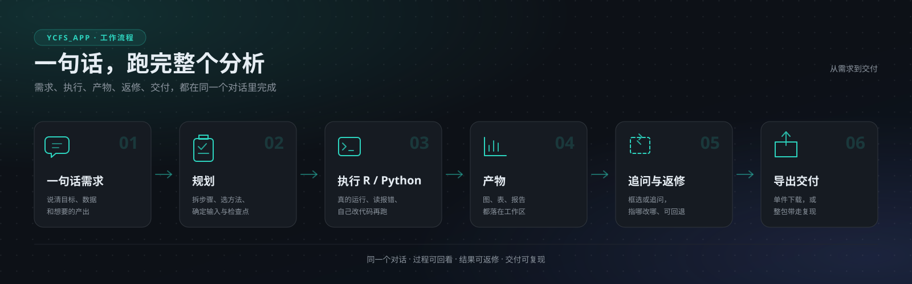
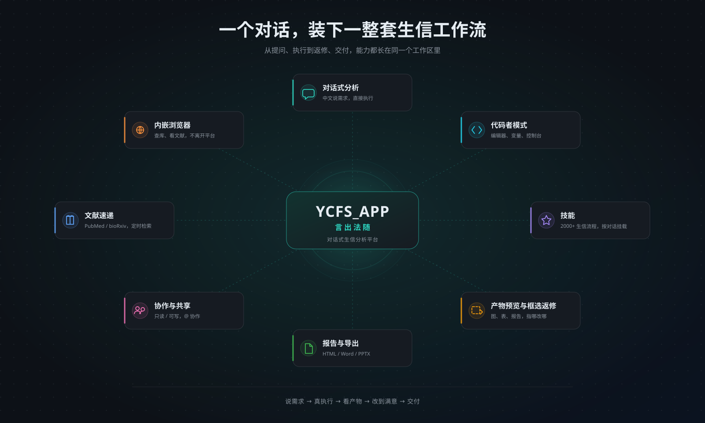
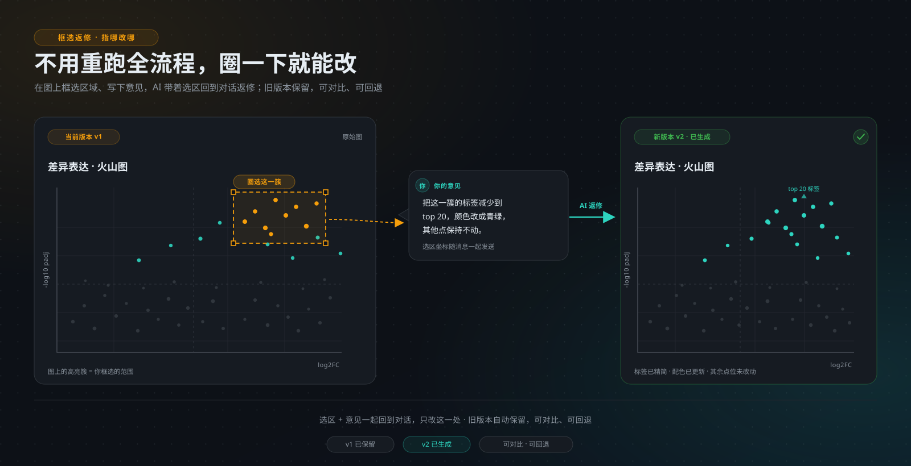
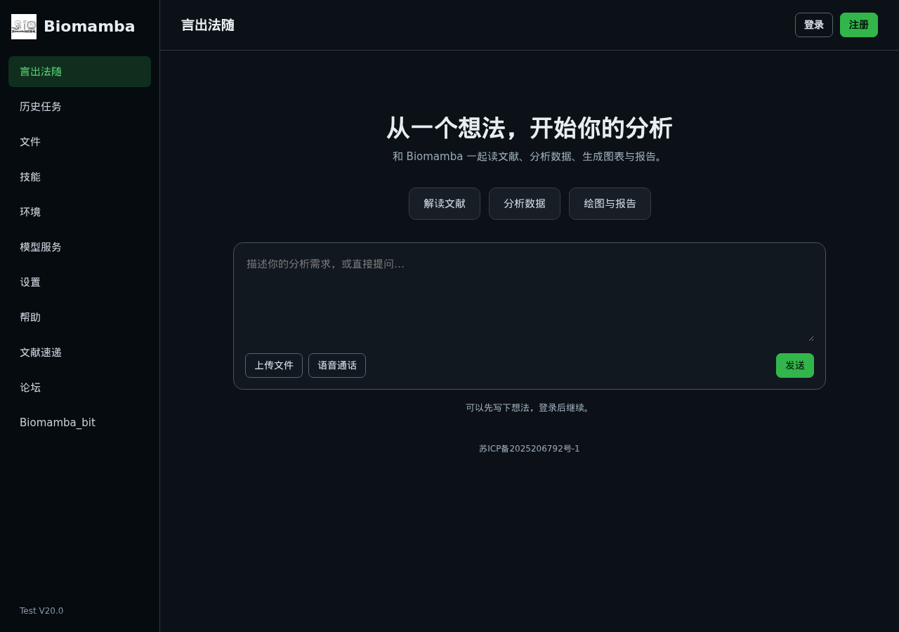
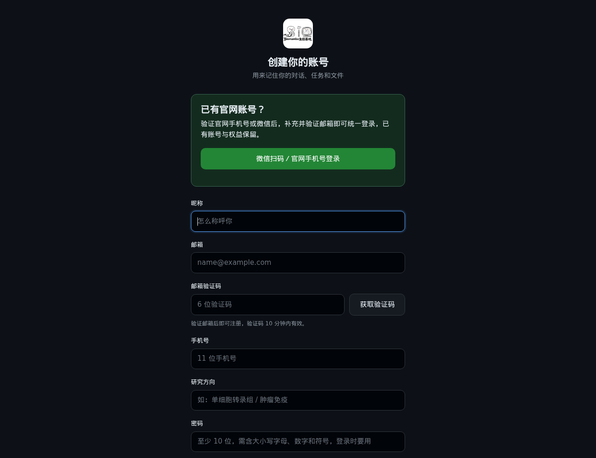

# YCFS_APP · 言出法随

**面向生物信息学的可执行 AI 分析平台。**

你只需要说清楚想做什么分析，平台里的 AI 会在一个隔离的工作区里写 R / Python / Bash、真的把分析跑起来、读取结果和报错、自己修正，最后把图、表、报告交回对话。

它不是“聊完给你一段代码”的聊天机器人。

**访问地址：<https://www.biomamba.cn/YCFS_APP/>**

**当前版本：Test V20.18**（2026-10-28）· [更新日志](CHANGELOG.md)

---

## 目录

## 它是什么

YCFS_APP（中文名“言出法随”）是一个跑在浏览器里的生信分析平台。

它的核心只有一件事：**把一句中文需求，变成一次真的执行。**

你描述目标，比如“用这份 count 矩阵做差异表达分析，按 padj < 0.05 且 |log2FC| > 1 筛基因，画火山图和热图，再生成一份 Word 报告”。平台会：

1. 理解需求，决定用什么方法、需要哪些输入；
2. 在属于这个对话的隔离工作区里写代码；
3. 真正运行 R / Python / Bash；
4. 读输出、读报错；失败就改代码再跑；
5. 把表、图、日志、报告留在工作区，等你查看和继续追问。

整个过程不需要你配环境、装软件、改路径，也不需要把报错复制到另一个聊天窗口里。

### 它不是什么

| 它不是 | 它是 |
|---|---|
| 一个只会回答问题的聊天机器人 | 一个会动手执行分析的工作台 |
| 一个代码生成器 | 一个把代码跑完、把产物交回来的平台 |
| 一个通用 AI 套壳 | 带生信技能、运行环境和产物体系的领域产品 |
| 一个“一键出结论”的黑盒 | 过程可回看、结果可追问、可返修的分析助手 |

## 它解决什么问题

做一次生信分析，难的往往不是“想法”，而是想法和结果之间的那一长串杂事。

- **环境配不起来**：R 与 Python 的环境版本互相打架；换一台机器又要重来。
- **脚本写不动**：知道要用 DESeq2 / Seurat，但参数、报错、文件路径每一处都能卡半天。
- **报错没人管**：跑挂了只能去搜、去问、去试；一个错误吃掉一整天。
- **长任务不敢等**：跑个单细胞要十几分钟，关掉页面就不知道还在不在跑。
- **结果散得到处都是**：图在一个文件夹，表在另一个，报告又是另写的。
- **改一张图要重跑全流程**：只想改配色或换分组，却得从头再跑一遍。
- **交付无法复现**：文章要补材料，别人问“你这张图怎么来的”，脚本和环境已经找不齐。
- **协作靠传文件**：同组的人想看进度，只能截图、打包、发微信。

YCFS_APP 把这些环节收进同一个对话：**需求、代码、运行、报错、产物、返修、报告、导出**都在一个地方完成。

## 你能做什么

### 对话式分析

- 用中文描述需求即可，不需要先学平台的语法。
- 可以上传表达矩阵、count 表、临床信息、图片、PDF、文本等文件，作为这一轮的输入。
- 平台只执行 R / Python / Bash 三种可执行代码；跑出来的结果、警告、报错都会回到对话里。
- 同一个对话里的变量会保留，可以接着上一轮继续算，不必每轮从头开始。
- 分析在后台任务里运行：关掉浏览器，任务继续跑；回来还能看到状态和产物。
- 任务有明确的成功、失败、超时、内存不足等状态，不会“转圈到天荒地老”。

### 代码者模式

给想自己动手的人：

- 编辑器、变量面板、控制台、工作区四块，可以拖动调整大小。
- 选中一段代码，写一句“这里改成按批次校正”，AI 直接给出新版代码和差异对比。
- 你可以选择保存为新版本、另存为，或者放弃这次修改。
- 覆盖原文件前会自动留一份备份，不会静默覆盖。

适合调参、复现别人的流程、教学演示，以及“我想自己掌控每一步”的场景。

### 技能

技能是这个平台和通用 AI 最大的差别之一。

- 平台内置两千余条生信相关技能，覆盖单细胞、转录组、空间转录组、生存分析、TCGA 挖掘、通路富集、科研绘图、文献检索等方向。
- 技能不是一段泛泛的提示词，而是把“这类分析该怎么做”的步骤、参数习惯、常见坑和检查点写成可复用的流程。
- 技能按对话挂载：只有你在这次对话里勾选的技能，才会参与这一轮的分析。
- 可以按分类、标签、作者筛选，找到需要的技能再挂上。

技能不会改变平台的安全边界，也不会替你做科学判断；它做的是把领域经验带进这次对话。

### 产物预览与圈选返修

- 图片、PDF、HTML、Markdown、Office 文档、表格、文本、压缩包、目录，都可以在平台内预览。
- Word / Excel / PowerPoint 会先转成 PDF 预览，不用下载再打开。
- PPTX 还能直接改文字和备注，改完保存回原文件。
- 报告页可以整页转成图片，你直接在页面上框选一段，写下“这里换成三线表”“这段结论再保守一点”，意见会带着选区回到对话，AI 据此返修。
- 图片也支持圈选局部再返修，比如圈出某个样本、某条通路，问“这里为什么偏高”。

### 报告与导出

- 分析做完后，可以让平台生成报告，格式可选 HTML、Word、PPTX，也可以自己指定。
- 报告是对话里的产物，不是一次性的下载链接；可以继续追问、继续改。
- 单个产物可以单独下载，图、表、PDF 都能拿走。
- 需要把整包带走时，平台会打包脚本、数据、运行说明和依赖清单，下载后可以在本地重跑。
- 这对论文补材料、交接给同事，或者把分析搬到自己的机器上很有用。

### 协作与共享

- 一个对话可以共享给其他账号，权限分只读和可写两档。
- 被共享的人打开对话时，会看到自己拿到的是只读还是可写。
- 可以在对话里 @ 参与者，提醒对方来看结果。
- 可以引用另一个对话的正文或某一条消息，把上下文带进来。
- 共享对话里的产物、预览和编辑，都会先检查你有没有这个对话的权限。

### 内嵌浏览器

- 对话页右下角有一个“浏览器”入口，点开是右侧抽屉，不用离开平台就能查网页。
- 它渲染的是真实浏览器画面，不依赖目标网站是否允许被嵌入。
- 有地址栏、前进后退、刷新，支持键盘输入和中文输入法。
- 自带网络面板，能看到页面的接口请求，方便排查“这个数据库为什么查不到”。
- 适合查在线数据库、看文献页面、登录需要账号的网站，再把看到的内容带回对话。

### 文献速递

- 在“文献速递”页填几个关键词，平台会新建一个对话，让 AI 去公开文献库里检索。
- 检索范围包括 Europe PMC、PubMed、bioRxiv、Crossref 等公开来源。
- 结果会按“精读”和“略读”两档整理成一份《文献速递.md》，放在这个对话的工作区里。
- 报告讲的是文献本身：主要结论、关键证据、有没有分歧；检索式和检索过程放在文末附录。
- 可以设定时订阅，到点自动跑一遍，结果留在工作区；站点配置了邮件服务时，也可以发到邮箱。

### 文件、任务与其它页面

- **文件**：每个对话有自己的工作区；另有共享文件区，带归属和权限，可以在线预览、下载、删除。
- **历史任务**：每次执行都有记录，能看到状态、耗时和产物；可以重跑，重跑的是这条任务所在的对话。
- **环境**：站点预置基础环境；每个对话还可以有自己的一层环境，你在某个对话里安装额外的软件，只影响这个对话，不会污染别的对话。
- **模型服务**：可以配置当前使用的模型服务；具体可用型号由站点配置决定。
- **论坛**：提问、求助、分享踩坑经验；发帖对所有用户可见，不要贴隐私数据。
- **设置与帮助**：界面皮肤、偏好设置、使用说明都在这里。

## 近期更新

倒序记录最近这段时间里你能直接感觉到的变化。每条末尾的括号是它落地的位置，方便对照。

- **2026-10-28｜模型协议自动识别**：在「模型服务」里接自己的模型渠道时不用再手选协议，平台会按端点的实际回应自动走通兼容协议，也不会去重试一条已经成功的流（`internal/llm/auto_protocol.go`）
- **2026-10-28｜技能智能匹配**：在技能面板里说这次要做什么，平台会从技能库里挑出对口的几条；也可以只给关键词，关键词模式不读你的对话内容，也不消耗模型额度（`internal/web/chat_skill_smart.go`、`internal/skills/recommend.go`）
- **2026-10-27｜产物目录导航**：「脚本 / 数据 / 图 / 报告 / 临时文件」点一下直达对应目录，「返回」回到对话根目录；深层目录不再把当前路径重复拼一遍（`web/static/chat.js` 的 `folders` 映射）
- **2026-10-27｜设置拆成四页**：「设置」分成界面、算力、运行、账号四页；来回切换不会清空没保存的凭证或草稿，也不会替你偷偷保存（`web/templates/panes/settings.html`）
- **2026-10-27｜充值开票 + 回复内补充意见**：已支付的充值订单多了「申请／查看发票」，填抬头、税号和服务项目后提交，管理员处理完你可以直接下载发票原件，税号只有申请人和有权限的管理员看得到；补充意见挪到了对应回复的下方，重绘后草稿、光标和选区都还在（`POST /api/invoices`、`POST /api/invoices/upload`、`GET /api/invoices/file`、`web/static/recharge.js`、`web/static/chat.js`）
- **2026-10-27｜公共文件区 + 充值账号内存默认 128 GB**：「文件」页多了「公共文件」，不绑定会话、仅自己可见，可以选中文件直接新建会话；现金充值的账号新建分析任务时默认内存上限提升到 128 GB，手动设过更大值的不受影响，跑着的任务也不受影响（`web/templates/panes/files.html`、`internal/store/paid_memory.go`）
- **2026-10-27｜生成过程不再"卡住"**：流式文字成段完整显示；折叠只看正文，不再把隐藏的思考过程算进去；你手动展开的消息不会被自动收起；未登录也可以先试三轮再决定要不要注册（`web/static/chat-messages.js`、`web/static/chat.js`、`internal/web/guest_trial.go`）
- **2026-10-27｜文献速递跟随主题**：浅色主题下文献速递不再出现深色卡片和发灰文字，搜索框、技能选择和阅读页都跟着当前皮肤走（`web/templates/panes/lit.html`、`web/static/lit.js`）

## 我们对你的保障

分析跑得越久，你越会关心一件事：机器出问题的时候，我的数据还在不在。这一节只讲结果，不讲架构。

- **分析跑到一半也不会丢**：切换前先停写，数据库和文件做最终同步，在跑的任务保留。
- **不会"切了却少几分钟数据"**：接管前逐文件核对，多、漏、越界、中途变动的副本一律拒绝。
- **备机不是"备份躺在那里"**：在隔离环境里真的把网页、R、Python 跑起来才算过。
- **算力节点逐个实测**：全部连通才允许接管。
- **切换窗口里旧服务不会被自动拉起**：预置保护条件，避免两边同时写。
- **切换出问题可以安全重跑**：重跑读此前保存的确认记录，不靠"接口不通"猜安全。
- **不是纸面架构**：每天都在演练；最近一次真实双进程演练覆盖请求保留、副本能否启动、故障重跑。

一句话：我们宁可切换得慢一点，也不让你在事后才发现少了一段数据。

## 怎么用

### 1. 打开网站

浏览器访问 **<https://www.biomamba.cn/YCFS_APP/>**。

### 2. 注册与登录

- 用邮箱和密码注册。密码至少 10 位，需要同时包含大写字母、小写字母、数字和符号。
- 注册是开放的；部分站点可能需要管理员审核后才能登录，以页面提示为准。
- 同一个账号同一时间只允许一个端在线，换设备登录会把另一台顶下线。

### 3. 新建一个对话

登录后进入“言出法随”，点“新建对话”。

如果这次要做的是单细胞、差异表达、生存分析之类的任务，可以先在技能面板里勾上对应技能；不勾也能用，勾了会让 AI 更按这类分析的标准流程走。

### 4. 把需求说清楚

直接说目标、数据、分组、阈值和你想要的产出。越具体，第一轮越接近你想要的结果。

例如：

> 附件是 12 个样本的 count 矩阵和分组表，做差异表达分析。
> 分组是 control 和 treatment，按 padj < 0.05、|log2FC| > 1 筛基因。
> 画 PCA 图、火山图和 top 50 热图，再做 GO 和 KEGG 富集。
> 最后生成一份 Word 报告，方法部分写清楚用了什么方法和参数。

### 5. 看它跑

发送后，平台会开始执行。你能看到任务状态、代码、运行日志和已用时间。

如果报错，不需要你自己修；把报错留在对话里，AI 会读着报错改代码继续跑。你也可以直接说“这个报错什么意思，换个方法”。

### 6. 看产物、继续追问

产物会出现在对话的工作区里。点开就能预览，图可以放大，表可以翻页，PDF 和 Office 可以直接看。

不满意就继续说：

- “火山图标签太密了，只标 top 20。”
- “热图按行做 z-score，加样本分组注释。”
- “这个通路富集结果里为什么没有我要的通路？”

### 7. 生成报告、导出、共享

- 点“生成报告”，选 HTML、Word 或 PPTX。
- 需要交付就导出；需要整包带走就下载分析包。
- 需要同组的人一起看，就共享对话，选只读或可写。

## 适用人群

- **高校课题组**：PI、博后、研究生，组里有人会写代码，但不想每个人都从配环境开始。
- **研究所与医院科研岗**：有数据、有分析需求，但没有专职生信工程师。
- **药企与生物公司早期研发**：需要快速做探索性分析，并把过程和结果留下来。
- **教学与培训**：给每个学生一个账号和一个独立工作区，布置同一套分析任务，互不干扰。
- **想自己写代码的人**：用代码者模式，把环境、运行、预览、版本管理交给平台。
- **只需要结果的人**：不懂代码，但能说清楚自己要什么，也能看懂图和报告。

## 典型场景

| 场景 | 你可以这样说 | 平台会做什么 |
|---|---|---|
| 转录组差异表达 | “做 DESeq2 差异分析，筛 padj < 0.05，画火山图和热图” | 读取 count 矩阵和分组，跑差异分析，出图、出表、做富集 |
| 单细胞分析 | “这份 10x 数据做 QC、聚类、UMAP 和细胞类型注释” | 用 Seurat / Scanpy 走标准流程，给出分群图、marker 表和注释结果 |
| 空间转录组 | “按空间位置做区域聚类，找区域差异基因” | 结合表达和空间坐标做聚类、邻域分析、区域差异 |
| 生存分析与 TCGA | “用 TCGA 数据做生存分析，画 KM 曲线和森林图” | 整理临床和表达数据，做 Kaplan-Meier、Cox 回归、风险表 |
| 通路与富集 | “对差异基因做 GO / KEGG / GSEA” | 富集分析、通路可视化、结果表 |
| 科研绘图 | “按期刊要求重画这张图，字号 8pt，导出 PDF” | 调整配色、字号、布局，输出可投稿的图 |
| 文献速递 | “每周看单细胞注释的新文献” | 定时检索、筛选、精读、生成速递 |
| 教学实训 | “给全班布置同一个差异分析任务” | 每人独立对话和工作区，互不影响 |

## 常见问题

| 问题 | 回答 |
|---|---|
| 需要会写代码吗？ | 不需要。用中文说需求就行；想自己写，可以开代码者模式。 |
| 和直接问 AI 有什么区别？ | 直接问 AI，你拿到的是文字或代码；在这里，代码会真的被执行，产物会真的落在工作区里，还能预览、返修、导出。 |
| 支持哪些分析语言？ | R、Python、Bash。平台内置大量生信技能，常用的差异表达、单细胞、富集、生存分析、绘图都有对应流程。 |
| 关掉浏览器，任务会停吗？ | 不会。任务在后台继续跑，回来还能看到状态和产物。 |
| 结果不对怎么办？ | 直接在对话里说哪里不对，或者圈选图上的区域、指出报告里的段落，让 AI 返修。也可以让它解释用了什么方法、什么参数。 |
| 数据安全吗？ | 每个对话有独立工作区，共享和访问都按对话权限判断。但涉及敏感数据时，仍请先确认单位的合规要求。 |
| 可以私有化使用或商用吗？ | 本仓库只放产品介绍，不包含源代码。私有化、定制技能、教学合作等，请联系作者。 |

## 反馈与许可

- 使用问题、功能建议、缺陷反馈：<https://github.com/Biomamba/YCFS_APP/issues>
- 本仓库仅用于介绍产品，不发布源代码。
- 仓库未声明开源许可，默认保留所有权利；如需使用、分发或商用，请先联系作者。
- 平台内使用的第三方技能与组件，遵循各自的许可。

---

**YCFS_APP · 言出法随** —— 把“我想做这个分析”，变成“这个分析已经跑完了”。
