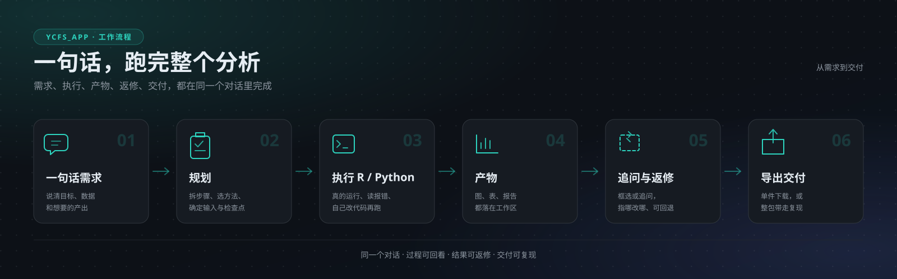

# 言出法随 · YCFS_APP

言出法随是 Biomamba 的生信分析与文献阅读工作台。在浏览器里打开一个会话，上传数据、说明分组和研究问题，就可以运行 R、Python 或 Bash。脚本、执行日志和结果文件都留在这个会话里，改参数或补图时可以接着做。

[进入工作台](https://www.biomamba.cn/YCFS_APP/) · [文献速递使用指南](https://www.biomamba.cn/YCFS_APP/guide/literature) · [更新日志](CHANGELOG.md)

## 从一份表达矩阵开始

把原始计数矩阵和样本信息表上传到同一个会话。第一次提问可以具体到要检查哪两列：

> 先核对矩阵列名和样本表的 sample_id，列出缺失和重复项。确认分组无误后，用 DESeq2 比较处理组和对照组，导出完整结果表，并标明 log2FoldChange 的方向。

在执行记录里可以查看实际运行的代码、参数和退出状态。需要复核某个基因，就打开结果表；需要调整火山图，就在原会话里指定阈值、标签或配色。项目完成后可以下载脚本、图表和报告，也可以把会话以只读或可写权限分享给同事。

## 围绕一个问题读文献

在「文献速递」新建检索，填入关键词、年份、阅读方式和篇数。如果只关心某类证据，可以直接写进要求，例如“找有独立队列验证的研究，并注明发现队列和验证队列各有多少人”。

- **解读与报告**按项目保存题录和阅读结果。有可用原图时，可以对照图注和报告解读，再打开论文核对样本、分组和统计单位。
- **文献思路图**可以只画指定的一篇文章。选「技术路线图」，能沿着样本来源、分析方法和验证结果阅读，每个阶段可对照报告段落。
- **学术前沿订阅**沿用当前项目的检索条件，按设定的频率跟进同一主题。

## 复核、返修和交接

可以在图或报告预览中圈出要修改的位置，随选区写下具体意见。比如“标出这个离群样本的编号，先保留它，再比较剔除前后的结果”。同事接手时，可以从原始输入、执行记录和产物查起。用于教学的项目也可以从工作台生成教案。

## 反馈与许可

遇到问题时，请附上操作步骤、页面提示和平台版本，方便复现。[提交问题或建议](https://github.com/Biomamba/YCFS_APP/issues)

本仓库用于产品介绍。平台源代码未公开，仓库保留所有权利。如需分发、商用、私有化部署或教学合作，请联系作者。第三方技能和组件遵循各自许可。